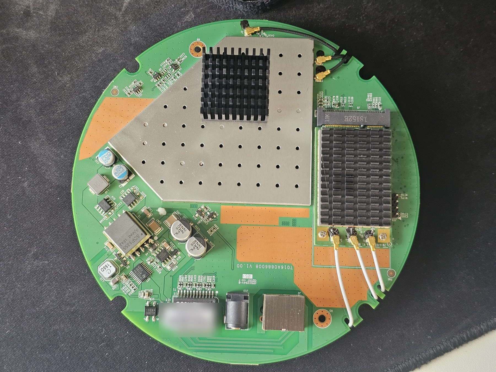

# OpenWrt for the Fortinet FortiAP-321C

Run the Fortinet FortiAP-321C (FAP-321C) as an ordinary standalone Wi-Fi access
point with OpenWrt. You don't need a FortiGate, FortiCloud or any Fortinet account.

This repository holds an OpenWrt device port (ath79 target), build instructions,
and an installation procedure that was tested end to end on real hardware.

> **Status:** working on one unit (board 7016A0886008 V1.00, U-Boot "FortiAP-321C (Jan 19 2018)").
> This port is not part of upstream OpenWrt. Patches for OpenWrt v25.12.5 and `main` are in
> [`patches/`](patches/).

## What works

| Feature | Status |
|---|---|
| Boot of the initramfs image over U-Boot TFTP | ✅ tested |
| Install with `sysupgrade` and boot from flash | ✅ tested |
| Warm reboot, persistent settings (jffs2 overlay, 24.7 MB) | ✅ tested |
| Gigabit Ethernet (AR8035) | ✅ tested |
| 2.4 GHz AP (ath9k): WPA2/WPA3 clients, DHCP and internet through the AP | ✅ tested |
| 5 GHz AP (ath10k-ct, QCA9880): WPA2/WPA3 clients, DHCP and internet through the AP | ✅ tested |
| MAC addresses identical to the vendor firmware | ✅ tested |
| Radio calibration data from flash | ✅ tested |
| LEDs | ⚠️ registered, not visually verified |
| Reset button | ⚠️ not tested |
| `factory.bin` through the vendor `restore` command | ❌ not tested; use the serial method |
| Returning to the vendor firmware from a backup | ⚠️ procedure documented, not tested |

## Hardware

| | |
|---|---|
| SoC | Qualcomm Atheros QCA9558, 720 MHz |
| RAM | 256 MiB DDR2 |
| Flash | 32 MiB SPI NOR (Winbond W25Q256JV) |
| 2.4 GHz | QCA9558 WMAC, 3x3 b/g/n |
| 5 GHz | QCA9880 mini-PCIe card, 3x3 a/n/ac |
| Ethernet | 1x GbE, AR8035-A PHY, 802.3af PoE |
| Console | internal 4-pin header **J10**, 3.3 V TTL, 9600 8N1 |

The board is a Senao design shared with the WatchGuard AP300. The flash layout and
bootloader behaviour match the Fortinet FAP-221-C, which OpenWrt already supports.
Details are in [docs/HARDWARE.md](docs/HARDWARE.md).



## Installing

You need a **3.3 V USB-TTL serial adapter**. A USB-to-RJ45 "console cable" will not
work, because the 321C's only RJ45 port is Ethernet. You also need a PC with a TFTP
server and an Ethernet cable.

The short version:

1. Open the case and connect the adapter to **J10**: pin 2 to GND, pin 3 to RXD,
   pin 4 to TXD. Leave pin 1, marked ▲, unconnected.
2. At power-on press **Ctrl+C**, then **`k`**, then password **`1`** to get the `fap>` prompt.
3. Give the PC the address 192.168.1.10 and connect it to the AP. Then run
   `tftpboot 0x80100000 <initramfs image>` and `bootm 0x80100000`.
4. In OpenWrt (192.168.1.1), **back up all six mtd partitions**.
5. Copy the sysupgrade image to `/tmp` and run `sysupgrade -n` **from the serial console**.

Follow the full guide, warnings included: [docs/INSTALL.md](docs/INSTALL.md).

> ⚠️ **Never** use the boot menu's `G` option, or the U-Boot `lu` / `lf` / `lk` scripts,
> `saveenv`, `erase`, `cp.b` or `protect`. Fortinet's U-Boot writes flash without
> respecting partition boundaries and can destroy the radio calibration data or the
> bootloader itself.

## Building

```sh
./scripts/build.sh patches/openwrt-v25.12.5/0001-ath79-add-support-for-Fortinet-FAP-321-C.patch
```

The script clones OpenWrt v25.12.5 and applies the patch. It then builds the
initramfs, factory and sysupgrade images with LuCI included, on Debian or Ubuntu as
a normal user. Prebuilt images, if published, are attached to the GitHub releases
with SHA-256 checksums.

## Recovery

U-Boot and the calibration partition are read-only in OpenWrt, and `sysupgrade`
never touches them. If OpenWrt fails to boot, interrupt U-Boot over serial,
TFTP-boot the initramfs image again, and reflash or restore your backup.
See [docs/RECOVERY.md](docs/RECOVERY.md).

## Credits

This port combines existing OpenWrt work. Thanks to:

- **MeestaR** and the participants of OpenWrt forum thread
  [*Adding OpenWrt support for Senao like Devices*](https://forum.openwrt.org/t/adding-openwrt-support-for-senao-like-devices/88170),
  who first booted OpenWrt on a 321-C.
- **RuhanSA079**, for the unmerged
  [FAP-321-C work in progress](https://github.com/RuhanSA079/openwrt/commit/31c2f03c20803c4782e556f52baf371c04dcbdc6)
  (GPIO mapping and pinout).
- **mpratt14**, for the Senao loader support and the OEM to OpenWrt partition mapping.
- The authors of the OpenWrt **Fortinet FAP-221-C** and **WatchGuard AP300** ports,
  which this port is assembled from.

## Disclaimer

This project is not affiliated with or endorsed by Fortinet. FortiAP is a trademark of
Fortinet, Inc. Flashing third-party firmware can permanently damage your device and
voids any warranty. Do not redistribute Fortinet firmware or flash dumps. A full dump
contains your unit's serial number, MAC addresses and proprietary code.

## License

GPL-2.0-only, the same as OpenWrt. See [LICENSE](LICENSE). The device tree source is
`GPL-2.0-or-later OR MIT`, as stated in the file.
