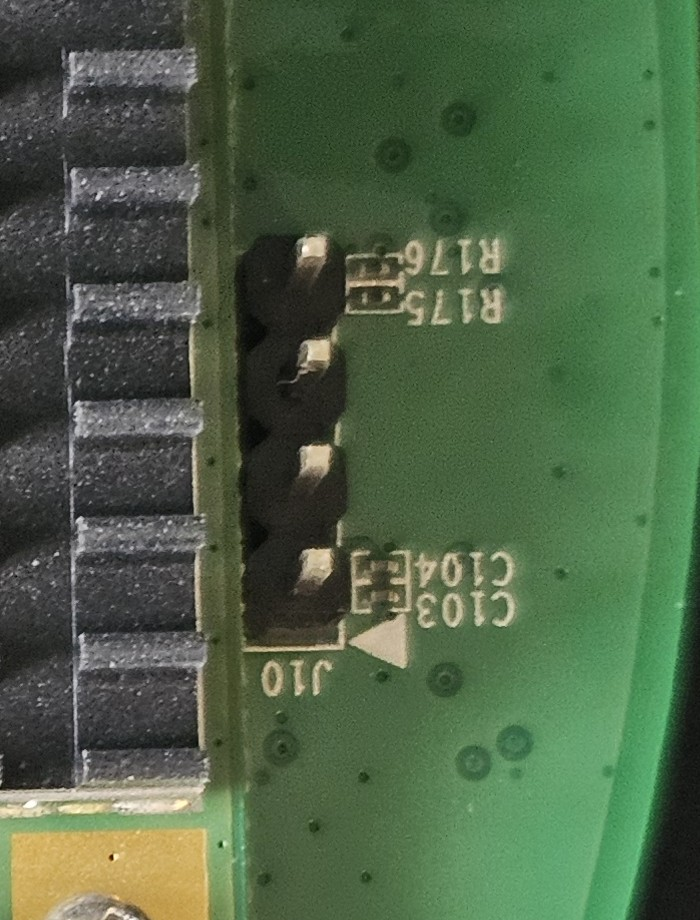

# Installing OpenWrt on the FortiAP-321C

This is the procedure that was used and verified on real hardware. Steps 1 to 6 write
nothing to flash: OpenWrt runs from RAM. Only step 7 writes flash.

## What you need

- A **3.3 V USB-TTL serial adapter** (FT232, CP2102, CH340…). If it has a voltage
  jumper, set it to **3.3 V**.
- A Linux, macOS or Windows PC with a serial terminal (picocom, minicom, PuTTY…) and a
  **TFTP server**.
- An Ethernet cable from the PC straight to the AP. Keep the AP **off your main
  network** until OpenWrt is configured. OpenWrt's defaults (192.168.1.1, a DHCP
  server, IPv6 router advertisements) will disturb a normal LAN.
- The 12 V DC adapter for power. The PC's Ethernet port does not supply PoE.
  Never connect DC power and PoE at the same time.

## 1. Open the case and find J10

J10 is the populated 4-pin header next to the mini-PCIe Wi-Fi card. **Pin 1 is
marked with ▲** next to C103/C104.



| J10 pin | Signal | Connect to adapter |
|---|---|---|
| 1 (▲, next to C103/C104) | 3.3 V | **nothing** |
| 2 | GND | GND |
| 3 | TX (AP output) | RXD |
| 4 (next to R175/R176) | RX (AP input) | TXD |

Do not connect the adapter's VCC pin. The AP powers itself.

R175 and R176 are footprints on the RX line. On the tested unit, RX worked without
modification. If you can read the boot messages but typed characters do nothing,
inspect R175 and R176. **Never bridge R176**: on this board family it pulls RX to
ground.

## 2. Watch the boot and stop at the bootloader

Open the serial port at **9600 8N1**, without flow control, then power on the AP.
Send **Ctrl+C** as soon as text appears. You will get the boot menu:

```
[G]:  Get OS image from TFTP server.
[Q]:  Quit menu and continue to boot with default OS.
[H]:  Display this list of options.
Enter G,Q,or H:
```

> ⚠️ Do **not** press `G`. It downloads an image and **writes it to flash**,
> ignoring partition boundaries.

Press **`k`**. At `Enter password:` type **`1`** and Enter. You get the full
U-Boot prompt:

```
fap>
```

Notes about this U-Boot:

- Pressing Enter on an empty line **repeats the previous command**.
- Its environment contains factory scripts `lu`, `lf` and `lk` that erase and write
  flash. `run lu` would overwrite the bootloader. Never run them, and never use
  `saveenv`, `erase`, `cp.b` or `protect`.
- It uses `ipaddr=192.168.1.1` and `serverip=192.168.1.10`. The settings are not
  saved ("Using default environment"), so don't try to save any.

A sample console session is in [uboot-console.txt](uboot-console.txt).

## 3. Network and TFTP server

Set the PC's Ethernet to **192.168.1.10/24** and put
`openwrt-ath79-generic-fortinet_fap-321-c-initramfs-kernel.bin` in the TFTP root.
Check the link from U-Boot:

```
fap> ping 192.168.1.10
host 192.168.1.10 is alive
```

## 4. Boot OpenWrt from RAM

```
fap> tftpboot 0x80100000 openwrt-ath79-generic-fortinet_fap-321-c-initramfs-kernel.bin
fap> crc32 0x80100000 <size in hex from the tftpboot output>
fap> bootm 0x80100000
```

Compare the `crc32` result with the file's CRC32 on the PC, for example
`python3 -c "import zlib,sys;print('%08x'%zlib.crc32(open(sys.argv[1],'rb').read()))" file`.
`bootm` also verifies the image checksum.

Transfers worked at full speed on the tested unit. On some Fortinet units TFTP
reportedly fails on large files. If that happens, lower the PC's MTU, for example
to 600, or try a different TFTP server.

The kernel reports `MIPS: machine is Fortinet FAP-321-C`. Press Enter at
`Please press Enter to activate this console.`

## 5. Get SSH access

OpenWrt is now at **192.168.1.1**, and root has no password. You can reach it with
`ssh root@192.168.1.1`, or by pasting your public key on the serial console:

```sh
echo 'ssh-ed25519 AAAA... you@pc' > /etc/dropbear/authorized_keys
```

## 6. Back up the flash (do not skip)

Copy all six partitions to the PC:

```sh
for n in 0 1 2 3 4 5; do ssh root@192.168.1.1 "cat /dev/mtd$n" > mtd$n.bin; done
```

| mtd | name | size | contents |
|---|---|---|---|
| 0 | u-boot | 256 KiB | bootloader, MAC address, serial number |
| 1 | fwconcat0 | 20 MiB | vendor rootfs |
| 2 | loader | 64 KiB | first block of the vendor kernel |
| 3 | fwconcat1 | 3.9 MiB | rest of the vendor kernel |
| 4 | reserved | 7.7 MiB | vendor data |
| 5 | art | 64 KiB | radio calibration |

Read each partition at least twice and compare checksums. The total must be exactly
**33554432 bytes**. Keep the backup private: it contains your serial number, your MAC
addresses and Fortinet's firmware.

This is also a good moment to check the hardware: `dmesg`, `iw dev`, `ls /sys/class/leds`.

## 7. Install (writes flash)

```sh
scp -O openwrt-ath79-generic-fortinet_fap-321-c-squashfs-sysupgrade.bin root@192.168.1.1:/tmp/
```

Then **on the serial console**:

```sh
sysupgrade -T /tmp/openwrt-ath79-generic-fortinet_fap-321-c-squashfs-sysupgrade.bin   # test only
sysupgrade -n /tmp/openwrt-ath79-generic-fortinet_fap-321-c-squashfs-sysupgrade.bin
```

Run `sysupgrade` on the serial console or in an SSH session you keep open. Started
in the background over SSH, it was killed without doing anything.

`sysupgrade` writes only the `loader` and `fwconcat0` partitions, then reboots. U-Boot
boots the OpenWrt loader from the old kernel location, and the loader starts the kernel:

```
## Booting image at a0440000 ...
OpenWrt kernel loader for AR7XXX/AR9XXX
Looking for OpenWrt image... found at 0xbf040000
```

On the first boot OpenWrt formats about 25 MB of settings storage, which takes a
couple of minutes. Wait for `mount_root: switching to jffs2 overlay` before changing
settings, or reboot once. A complete log is in
[bootlog-sysupgrade-and-first-boot.txt](bootlog-sysupgrade-and-first-boot.txt).

## 8. Configure as a plain access point

On the private cable, set a password and Wi-Fi. `radio1` is 2.4 GHz and `radio0` is 5 GHz.

```sh
passwd
uci set wireless.radio1.country='US'; uci set wireless.radio0.country='US'
uci set wireless.radio1.disabled='0'; uci set wireless.radio0.disabled='0'
for r in 0 1; do
  uci set wireless.default_radio$r.ssid='YourNetwork'
  uci set wireless.default_radio$r.encryption='sae-mixed'   # WPA2/WPA3
  uci set wireless.default_radio$r.key='YourPassphrase'
  uci set wireless.default_radio$r.disabled='0'
done
uci commit wireless; wifi reload
```

To extend an existing network, use the same SSID and passphrase as your router but
**different channels**.

Then hand addressing over to your router. Do this on the serial console, because the
AP leaves 192.168.1.1:

```sh
uci set network.lan.proto='dhcp'
uci -q delete network.lan.ipaddr; uci -q delete network.lan.ip6assign
uci set dhcp.lan.ignore='1'
uci set dhcp.lan.dhcpv4='disabled'; uci set dhcp.lan.dhcpv6='disabled'; uci set dhcp.lan.ra='disabled'
uci commit network; uci commit dhcp
/etc/init.d/odhcpd disable; /etc/init.d/odhcpd stop
/etc/init.d/network reload
```

Plug the AP into your network. Your router gives it an address. The LuCI web
interface is at `http://<that address>/`; log in as `root` with the password you set.
